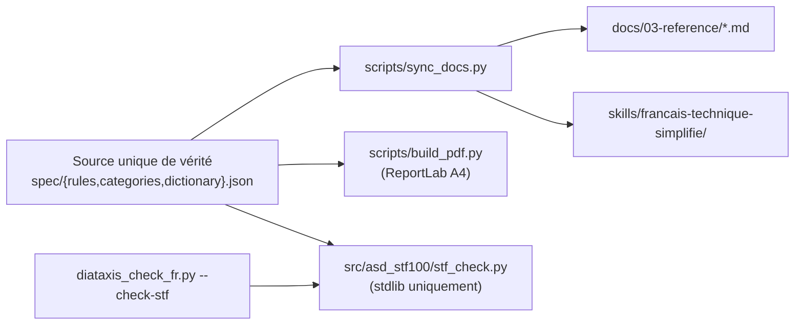

# ADR-001 : Adaptation française d'ASD-STE100 et architecture à source unique

| Attribut | Valeur |
| :--- | :--- |
| **Statut** | Accepté |
| **Date** | `2026-11-23` |
| **Décideurs** | Mainteneurs ASD-STF100 |
| **Remplace** | Aucun |

## Contexte

Les équipes techniques francophones manquent d'une spécification ouverte, vérifiable
automatiquement par un linter et intégrée nativement à une chaîne Diátaxis Docs-as-Code.
Transposer littéralement un dictionnaire anglais existant poserait deux problèmes majeurs :
une incompatibilité linguistique (accords, traits d'union, formes verbales françaises)
et un risque juridique vis-à-vis de la propriété intellectuelle de l'ASD sur **ASD-STE100**.

L'architecture retenue doit satisfaire trois contraintes simultanées :

- **Indépendance linguistique et juridique :** formuler 53 règles, 22 catégories de noms,
  4 catégories de verbes, un dictionnaire français original et des exemples originaux
  sous licences MIT / CC-BY-SA-4.0, avec mention explicite de non-affiliation.
- **Zéro dérive entre supports :** alimenter la documentation Markdown, les Agent Skills,
  le linter Python et la spécification PDF depuis une seule source structurée.
- **Exécution portable sans dépendance lourde :** exécuter `stf_check.py`,
  `scaffold_diataxis_fr.py` et `diataxis_check_fr.py` avec la seule bibliothèque standard Python 3.10+.

## Vue d'architecture

## Options envisagées et compromis

| Option | Cohérence multi-supports | Portabilité CI et Skills | Risque juridique | Verdict |
| :--- | :--- | :--- | :--- | :--- |
| **Option A : Source unique JSON (`spec/*.json`) + scripts stdlib + ReportLab** | Élevée (vérifiée par `sync_docs.py --check`) | Maximale (aucune dépendance externe pour les linters) | Nul (contenu français 100 % original) | **Retenue** |
| **Option B : Rédaction séparée du Markdown et du PDF** | Faible (dérive rapide entre PDF et docs) | Moyenne | Nul | Rejetée |
| **Option C : Linter dépendant de SpaCy ou NLTK** | Élevée | Faible (modèles lourds lents en CI et Skills) | Nul | Rejetée |

## Décision

Adopter l'**Option A** : centraliser les données normatives dans `spec/*.json`,
synchroniser les fichiers Markdown de référence et les skills via `scripts/sync_docs.py`,
maintenir les outils CLI en bibliothèque standard Python pure et compiler la norme PDF avec ReportLab.

## Conséquences

### Positives

- Toute évolution d'une règle ou d'une entrée du dictionnaire met à jour simultanément
  la documentation Markdown, les Agent Skills et la spécification PDF.
- Les deux skills (`francais-technique-simplifie` et `diataxis-docs-fr`) fonctionnent
  hors ligne sans installation préalable de paquets tiers.
- Les frontières juridiques entre le code (MIT), la spécification (CC-BY-SA-4.0)
  et la marque déposée tierce (`ASD-STE100`) restent explicites dans `NOTICE.md`.

### Négatives et contraintes opérationnelles

- Les contributeurs doivent modifier `spec/*.json` puis exécuter `python scripts/sync_docs.py`
  plutôt que d'éditer les fichiers générés sous `docs/03-reference/` ou `skills/`.
- L'analyse morphosyntaxique par expressions régulières et lexique contrôlé ne remplace
  pas la validation sémantique humaine du sens approuvé.

## Références et procédures associées

- Commandes CLI et synchronisation : [Commandes CLI et codes retour](../03-reference/cli-et-codes-retour.md)
- Régénération du document PDF : [Générer le PDF de spécification](../02-guides-pratiques/generer-pdf-specification.md)
