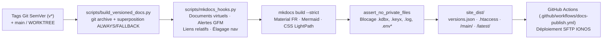

# ADR-002 : Publication MkDocs Material versionnée sur IONOS

| Attribut | Valeur |
| :--- | :--- |
| **Statut** | Accepté |
| **Date** | `2026-11-23` |
| **Décideurs** | Mainteneurs ASD-STF100, LightPath Documentation |
| **Remplace** | Aucun |

## Contexte

La documentation d'**ASD-STF100** rassemble quatre quadrants **Diátaxis (FR)** sous `docs/` et des documents racine de gouvernance (`README.md`, `CHANGELOG.md`, `CONTRIBUTING.md`, `NOTICE.md`).
Sa publication sur `https://asd-stf100.lightpath.fr/` (hébergement Apache IONOS) répond à quatre contraintes structurelles :

1. **Séparation des versions stables et du développement :** les lecteurs consultent la dernière release SemVer (`latest`).
   Ils gardent aussi un accès isolé à la version `main` (`/dev/`) et aux anciens tags (`v*`).
2. **Hébergement statique Apache sans moteur applicatif :** IONOS sert uniquement des fichiers HTML, CSS, JavaScript et SVG statiques.
   Un fichier `.htaccess` gère le routage `/`, `/latest/` et `/dev/` ainsi que les en-têtes HTTP de sécurité.
   Un manifeste `versions.json` alimente le sélecteur `provider: mike` de MkDocs Material.
3. **Unification des documents racine et des anciens tags :** les fichiers racine GitHub alimentent l'onglet `Versions et gouvernance` sans copie sur disque.
   Les tags précédents dépourvus de thème Material doivent compiler sans altération.
4. **Confidentialité et tests hors ligne :** aucun fichier `.kdbx`, `.keyx`, `.log` ou `.env*` ne doit atteindre `site_dist/`.
   Le module de hooks MkDocs doit rester testable sous `pytest` sans installation de MkDocs.

## Pipeline de compilation et de publication versionnée

## Options envisagées et compromis

| Option | Gestion des versions SemVer | Hébergement IONOS et sécurité | Cohérence GitHub et Diátaxis FR | Intégration CI et tests | Verdict |
| :--- | :--- | :--- | :--- | :--- | :--- |
| **Option A : Markdown brut sur GitHub uniquement** | Aucune navigation unifiée entre versions | Aucun site public, pas de recherche française | Liens racine et quadrants dispersés | Aucune compilation HTML `--strict` | Rejetée |
| **Option B : MkDocs Material non versionné (`main` seul)** | Mélange les nouveautés de `main` avec les releases publiées | Site statique possible sans routage `/latest/` ni `/dev/` | Exclut les fichiers racine sans copie manuelle | Ne teste pas la compatibilité des anciens tags | Rejetée |
| **Option C : Compilation statique multi-versions + superposition par hook + `.htaccess` IONOS** | Complète : construit `main` (`/dev/`) et chaque tag `v*` (`/latest/`) avec `versions.json` | Complète : `.htaccess` HTTPS `301`, alias `302`, en-têtes de sécurité et `assert_no_private_files` | Unifie les 4 quadrants français et 4 documents racine virtuels dans 6 onglets | Validée par `diataxis_check_fr`, `pytest`, `docs-ci.yml` et `docs-publish.yml` | **Retenue** |

## Décision

Adopter l'**Option C** : générer un assemblage statique multi-versions dans `site_dist/` avec `scripts/build_versioned_docs.py` et `scripts/mkdocs_hooks.py`.
Le flux `.github/workflows/docs-publish.yml` déploie ensuite ce résultat par SFTP vers IONOS.

Cette architecture repose sur quatre mécanismes principaux :

1. **Superposition non destructive sur snapshots Git (`scripts/build_versioned_docs.py`) :**
   - Découvre les tags SemVer (`v*`) triés du plus récent au plus ancien et produit `versions.json`.
   - Place l'alias `latest` sur le tag le plus récent et `dev` sur `main` (ou `["latest", "dev"]` sans tag).
   - Extrait chaque tag avec `git archive` dans un répertoire temporaire protégé contre la traversée de chemin.
   - Superpose `ALWAYS_OVERLAY_FILES` (`mkdocs.yml`, `scripts/mkdocs_hooks.py`, `docs/stylesheets/extra.css`, `docs/assets/logo.svg`) et `FALLBACK_OVERLAY_FILES` (`docs/index.md`).
   - Transmet `ASD_STF100_DOCS_REF` et `ASD_STF100_DOCS_SITE_URL` à `python -m mkdocs build --strict` pour chaque version.
2. **Hook MkDocs Material découplé (`scripts/mkdocs_hooks.py`) :**
   - Importe `mkdocs.structure.files` uniquement dans `on_files` pour garder le module testable sans MkDocs.
   - Injecte quatre documents virtuels (`overview.md` depuis `README.md`, `CHANGELOG.md`, `CONTRIBUTING.md`, `NOTICE.md`).
   - Découvre automatiquement `docs/RELEASE_NOTES_*.md` triés par SemVer inverse sous `Versions et gouvernance`.
   - Convertit les alertes GitHub (`[!NOTE]`, `[!TIP]`, `[!IMPORTANT]`, `[!WARNING]`, `[!CAUTION]`) hors blocs de code.
   - Applique `gfm_slugify` aux titres français accentués et réécrit les liens relatifs vers `docs/` ou vers GitHub `blob`/`tree` (dont `LICENSE`, `dist/ASD-STF100_ISSUE1.pdf` et `skills/`).
   - Élague les entrées absentes avec `prune_nav_for_existing_files`.
3. **Routage Apache statique sur IONOS (`.htaccess` et redirections HTML) :**
   - Écrit un fichier `.htaccess` avec `Options -Indexes -MultiViews`, `ErrorDocument 404` et compression `mod_deflate`.
   - Ajoute les en-têtes HTTP de sécurité, le cache sur `versions.json`, la redirection HTTPS `301` et les alias `302` (`/`, `/latest/`, `/dev/`).
   - Génère les pages HTML de repli `index.html`, `latest/index.html` et `dev/index.html`.
4. **Barrières de confidentialité et épinglage CI :**
   - Bloque `.kdbx`, `.keyx`, `.log`, `.env` et `.env.*` dans `mkdocs.yml` (`exclude_docs`), `on_files` et `assert_no_private_files`.
   - Épingle les actions GitHub par empreinte SHA-40 et transfère explicitement le fichier caché `.htaccess` dans `.github/workflows/docs-publish.yml`.

## Conséquences

### Positives

- **Séparation claire entre versions et flux continu :** les lecteurs accèdent à la version stable sur `/latest/` et à `main` sur `/dev/`.
  Le sélecteur `versions.json` permet une bascule directe entre versions.
- **Aucune duplication des fichiers de gouvernance :** `README.md`, `CHANGELOG.md`, `CONTRIBUTING.md` et `NOTICE.md` restent uniques à la racine.
  Le hook les intègre dans le sixième onglet `Versions et gouvernance` du portail.
- **Déploiement reproductible et vérifiable localement :** `build_versioned_docs.py` produit exactement l'arborescence téléversée sur IONOS et bloque toute fuite de secret.

### Négatives et risques opérationnels

- **Couplage des liens entre racine et portail :** tout nouveau document racine dépend de `VIRTUAL_DOCS` et de `rewrite_relative_links` dans `scripts/mkdocs_hooks.py`.
- **Dépendance aux modules Apache IONOS et au DNS :** `mod_rewrite` et le transfert explicite de `.htaccess` restent nécessaires.
  Les tests HTTPS finaux échouent tant que le DNS de `asd-stf100.lightpath.fr` pointe hors du serveur IONOS.
- **Épinglage des dépendances MkDocs :** `requirements-docs.txt` borne `mkdocs < 2.0` et `mkdocs-material < 10.0` pour maintenir la compatibilité des hooks Python.

## Références et guides associés

- Procédure opérationnelle de déploiement : [Publier la documentation sur IONOS](../02-guides-pratiques/publier-documentation-ionos.md)
- Structure et contrat Diátaxis FR : [Matrice Diátaxis (FR)](../03-reference/matrice-diataxis-fr.md)
- Commandes CLI et synchronisation : [Commandes CLI et codes retour](../03-reference/cli-et-codes-retour.md)
- Décision sur la source unique JSON : [ADR-001 — Adaptation française d'ASD-STE100](adr-001-adaptation-francaise.md)
