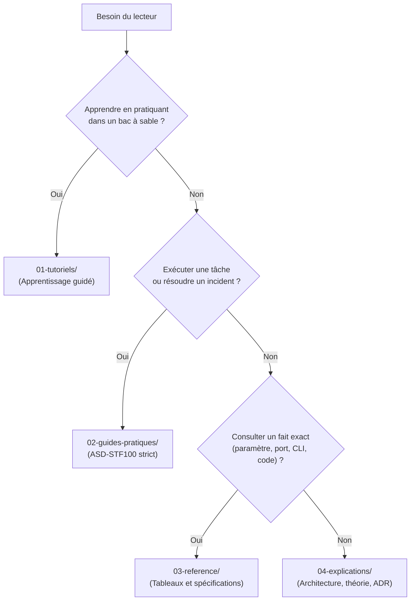
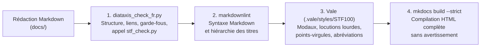

# Méthodologie Diátaxis et chaîne Docs-as-Code (FR)

La méthodologie **Diátaxis** résout le défaut le plus fréquent des documentations techniques :
le mélange de genres contradictoires au sein d'une même page.
Couplée à **ASD-STF100** et à une chaîne **Docs-as-Code**, elle transforme la documentation
d'infrastructure et logicielle en un actif vérifiable automatiquement à chaque Pull Request.

---

## 1. Les deux axes et les quatre quadrants

Diátaxis classe toute documentation technique selon deux axes orthogonaux :

- **Action vs Cognition :** l'utilisateur agit-il concrètement sur un outil,
  ou cherche-t-il à comprendre et consulter des faits ?
- **Acquisition vs Application :** l'utilisateur est-il en phase d'apprentissage,
  ou en situation de travail réel ?

| | **Pratique (Action)** | **Théorique (Cognition)** |
| :--- | :--- | :--- |
| **Acquisition (Apprendre)** | **1. Tutoriels (`01-tutoriels/`)**<br>Leçons guidées orientées apprentissage | **4. Explications (`04-explications/`)**<br>Architecture, compromis et dossiers ADR |
| **Application (Travailler)** | **2. Guides pratiques (`02-guides-pratiques/`)**<br>Procédures orientées objectif et runbooks | **3. Référence (`03-reference/`)**<br>Spécifications neutres, tableaux et CLI |



> **Règle d'or de Diátaxis :** Ne mélangez jamais deux genres sur une même page.
> Un guide pratique ne contient pas de cours d'architecture ; une page d'explication
> ne contient pas de séquence d'astreinte.

---

## 2. Rôle détaillé de chaque quadrant

### 1. Tutoriels (`01-tutoriels/`)

Le tutoriel accompagne un débutant vers une réussite reproductible dans un **environnement isolé**
(conteneur Docker, machine virtuelle locale ou répertoire temporaire).
Il garantit des résultats attendus visibles après chaque commande et écarte
les options alternatives qui sèmeraient le doute.

### 2. Guides pratiques (`02-guides-pratiques/`)

Le guide pratique ou runbook répond à un **objectif opérationnel réel**
(déployer, basculer, restaurer, sécuriser).
Dans l'écosystème **ASD-STF100**, ce quadrant est soumis au niveau d'exigence linguistique le plus élevé :

- Phrases procédurales limitées à **20 mots maximum**, à l'impératif direct et à la voix active.
- Consignes de sécurité classées par analyse de risque (`AVERTISSEMENT` pour risque humain,
  `ATTENTION` pour dommage matériel ou perte de données).
- Présence systématique d'une section de **Vérification** et d'une procédure de **Retour arrière** testée.
- Aucune digression théorique (`## Pourquoi`, `## Architecture`, `## Contexte`).

### 3. Référence (`03-reference/`)

La référence décrit la réalité technique du système de manière **sèche, neutre, exacte et exhaustive**.
Elle privilégie les tableaux Markdown normalisés : paramètres de configuration
(type, valeur par défaut, unité, plage), matrices de flux réseau, options CLI et matrices d'alertes.

### 4. Explications (`04-explications/`)

L'explication éclaire les **raisons, choix de conception, mécanismes internes et compromis**.
Elle rassemble les schémas d'architecture Mermaid, les analyses post-incident et les
*Architecture Decision Records* (ADR) sans dupliquer les procédures des runbooks.

---

## 3. Arborescence canonique et moteurs statiques

L'utilisation de préfixes numériques (`01-tutoriels/` à `04-explications/`) garantit
un ordre de navigation identique sur disque et dans les générateurs statiques
(**MkDocs Material**, **Docusaurus**, **Antora**).

```text
docs/
├── index.md
├── assets/
│   ├── architecture/
│   └── runbooks/
├── 01-tutoriels/
│   └── index.md
├── 02-guides-pratiques/
│   ├── index.md
│   ├── deploiement/
│   ├── exploitation/
│   ├── gestion-incidents/
│   └── securite/
├── 03-reference/
│   ├── index.md
│   ├── architecture-specs/
│   ├── configuration/
│   ├── cli-et-scripts/
│   └── codes-erreurs/
└── 04-explications/
    ├── index.md
    ├── vue-architecture/
    ├── decisions-architecture/
    └── analyses-internes/
```

| Moteur statique | Intégration de l'arborescence Diátaxis FR |
| :--- | :--- |
| **MkDocs Material** | L'option `navigation.indexes` transforme chaque `index.md` en page d'accueil de section cliquable, tandis que les préfixes numériques ordonnent la barre latérale. |
| **Docusaurus** | Les dossiers numérotés alimentent les barres latérales auto-générées et conservent des liens `.md` relatifs compatibles avec le versionnement. |
| **Antora** | Chaque quadrant se rattache aux entrées de `modules/ROOT/nav.adoc`, en gardant les schémas sous `assets/` séparés du texte. |

---

## 4. Le contrat de maillage inter-quadrants

Séparer les genres sans isoler l'information repose sur le **maillage** (*cross-linking*).
Chaque document pointe vers les autres quadrants au lieu de recopier leur contenu :

- **Un runbook (`02-guides-pratiques/`)** pointe en en-tête vers les seuils dans `03-reference/`
  et en pied de page vers le contexte système dans `04-explications/`.
- **Une matrice d'alertes (`03-reference/`)** associe chaque code d'erreur à un lien direct
  vers le runbook de remédiation dans `02-guides-pratiques/`.
- **Un dossier ADR (`04-explications/`)** renvoie vers la table de paramètres dans `03-reference/`
  et, si besoin, vers le guide de mise en œuvre dans `02-guides-pratiques/`.
- **Un tutoriel (`01-tutoriels/`)** propose en fin de parcours des liens vers les trois autres quadrants
  pour poursuivre au-delà du bac à sable.

---

## 5. Chaîne Docs-as-Code à quatre couches

La gouvernance documentaire ne repose pas sur la seule bonne volonté éditoriale ;
elle est vérifiée automatiquement par quatre outils complémentaires :



1. **Contrôle structurel et STF (`diataxis_check_fr.py --strict --check-stf`) :**
   vérifie l'arborescence, la validité des liens relatifs hors code, les garde-fous par quadrant
   et lance `stf_check.py --mode procedural` sur tout `02-guides-pratiques/`.
2. **Hygiène Markdown (`.markdownlint.json`) :**
   garantit l'unicité du titre de niveau 1 (`MD041`), les blocs de code clôturés (`MD046`)
   et la tolérance de largeur sur les tableaux de référence (`MD013`).
3. **Style Vale français (`.vale.ini` + `.vale/styles/STF100/`) :**
   bloque les modaux interdits (`ModauxInterdits.yml`), le point-virgule (`PointVirgule.yml`),
   les locutions lourdes (`LocutionsLourdes.yml`) et les abréviations latines (`AbreviationsLatines.yml`)
   dans `docs/02-guides-pratiques/**/*.md`.
4. **Publication stricte (`mkdocs.yml` + `.github/workflows/docs-ci.yml`) :**
   compile le site français avec MkDocs Material en mode `--strict` afin de détecter
   toute entrée orpheline ou ancre cassée avant fusion sur `main`.

## Documentation associée

- Tableau synthétique des règles : [Matrice Diátaxis (FR)](../03-reference/matrice-diataxis-fr.md)
- Guide de migration : [Migrer une documentation vers Diátaxis](../02-guides-pratiques/migrer-documentation-diataxis.md)
- Configuration du pipeline : [Configurer la CI Docs-as-Code](../02-guides-pratiques/configurer-ci-docs-as-code.md)
