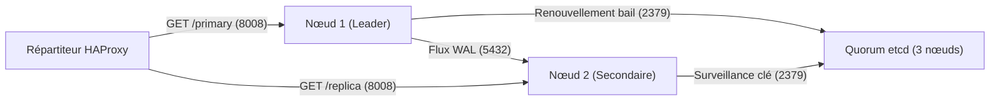

# ADR-001 : Stratégie de bail de consensus pour la haute disponibilité

| Attribut | Valeur |
| :--- | :--- |
| **Statut** | Accepté |
| **Date** | `AAAA-MM-JJ` |
| **Décideurs** | Comité d'architecture, Ingénierie Plateforme |
| **Remplace** | Aucun |

## Contexte

Les clusters de bases de données distribués exigent une élection déterministe du leader lors d'une panne machine ou d'une partition réseau.
S'appuyer uniquement sur des annonces ARP d'adresse IP virtuelle ou sur une bascule manuelle expose le cluster au risque de *split-brain* lorsque deux nœuds acceptent simultanément des écritures.

La plateforme doit respecter trois contraintes opérationnelles concurrentes :

- Temps maximal de reprise (RTO) inférieur à 30 secondes pour la perte d'un nœud unique.
- Zéro divergence d'écriture (*split-brain*) lors d'une partition réseau asymétrique.
- Comportement prévisible sans dépendance matérielle d'arbitrage propriétaire dans le cloud.

## Vue d'architecture

Lorsqu'un leader perd l'accès au quorum `etcd`, il ne peut plus renouveler son bail TTL et se rétrograde en lecture seule avant qu'un autre pair ne prenne le verrou.

## Options envisagées et compromis

| Option | Sûreté anti-split-brain | RTO de bascule | Complexité d'exploitation | Verdict |
| :--- | :--- | :--- | :--- | :--- |
| Option A : Consensus distribué (`etcd` + Patroni) | Élevée (bail à quorum garantissant un écrivain unique) | 15–30 secondes | Moyenne (quorum DCS à 3 nœuds) | **Retenue** |
| Option B : VIP Keepalived sans quorum | Faible (double primaire possible en partition) | 3–10 secondes | Faible (aucun magasin externe) | Rejetée |
| Option C : Bascule DNS manuelle | Élevée (validation humaine) | 5–15 minutes | Faible (hors objectif RTO) | Rejetée |

## Décision

Adopter l'Option A : utiliser un magasin de consensus `etcd` externe à 3 nœuds associé aux baux de leader Patroni (`ttl`, `loop_wait` et `retry_timeout`).

## Conséquences

### Positives

- Supprime les écritures concurrentes non coordonnées lors des partitions réseau.
- Expose des points de contrôle HTTP natifs pour les répartiteurs de charge TCP.

### Négatives et risques d'exploitation

- La perte simultanée de deux nœuds `etcd` sur trois suspend les écritures jusqu'au retour du quorum.
- Les équipes doivent surveiller la latence `fsync` des disques `etcd` afin d'éviter des expirations de bail intempestives.

## Références et procédures associées

- Délais exacts, ports et seuils : [Référence configuration](../../03-reference/configuration/parametres-cluster.md)
- Procédure d'astreinte associée : [Bascule manuelle du nœud primaire](../../02-guides-pratiques/gestion-incidents/bascule-primaire-manuelle.md)
